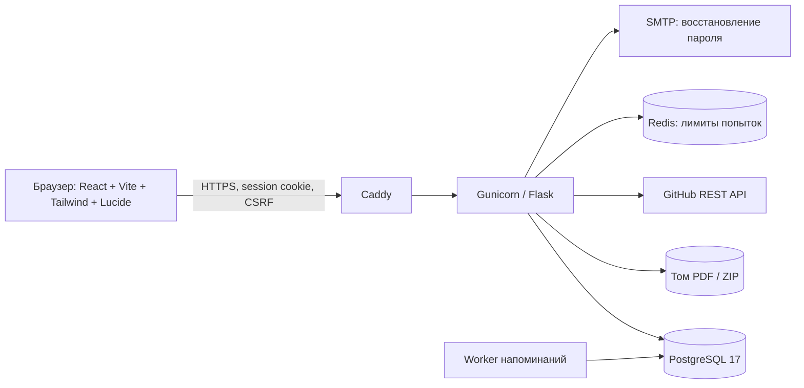

# Архитектура

## Компоненты

Flask — единственный backend. React обращается к REST Blueprint `/api`; Flask-Login использует HttpOnly-cookie с SameSite=Lax, CSRF токен выдаёт Flask-WTF. В production cookie Secure; frontend обслуживается тем же Flask origin.

## Данные

Модели в `backend/hackflow/models.py`; три Alembic/Flask-Migrate revision в `backend/migrations/versions`.

- User: глобальные права администратора/организатора/участника. EventRole: организатор и жюри **конкретного хакатона**. Капитан — поле команды, не глобальная роль. Экспертные права — ConsultationAssignment или ReviewAssignment(kind=expert).
- Hackathon → Admission, Case, Criterion, Team, Track, Material, Schedule.
- Team → Membership, JoinRequest, Task, Message, Upload, Submission, ConsultationAssignment, ConsultationComment.
- Submission → ReviewAssignment, JuryScore, ScoreHistory, PeerAssignment, PeerReview, CodeReport, AIReport, ExpertComment, Appeal.
- Media хранит безопасно пересохранённые аватары и обложки.
- User → Notification, Activity, LearningProgress, PersonalResult, PasswordReset, AuditLog.

`UNIQUE(user_id, hackathon_id)` в Membership обеспечивает одну команду на событие. Составной FK `(team_id, hackathon_id)` запрещает подменить хакатон для команды. Изменения состава блокируют строку команды (`FOR UPDATE`); уникальность Membership остаётся последним барьером при конкурентных запросах.

Важные изменения завершаются транзакцией `commit`; конфликт уникальности откатывает сессию и возвращает 409. POST/PATCH/DELETE проверяют права на сервере. Прямой API-вызов не обходит допуск или капитанские права.

## Сдача и оценивание

Одна итоговая отправка команды. В ней фиксируются название, описание, ссылки, PDF и конкретный ZIP исходников (при наличии). Новые загрузки после сдачи/дедлайна блокируются. Организатор может продлить дедлайн; изменение пишется в аудит.

Жюри получает только `{id, code, text}`, критерии и анонимный отчёт CodeCheck. Оригинальные ссылки, имена файлов, состав команды и авторство не сериализуются. Обезличивание выполняет организатор вручную и подтверждает проверку. Ссылки и email в обезличенном тексте запрещены. Автоматическое распознавание всех человеческих имён не обещается.

Консультирование до сдачи изолировано от жюри. Получивший доступ к авторству конкретного проекта не назначается на его анонимное оценивание.

Сумма максимумов критериев — 100; диапазон каждой оценки проверяется сервером. Итог проекта — средний суммарный балл его жюри. Ничья: раннее время сдачи, затем анонимный код. Публикация требует завершения всех назначенных проверок. Личный рейтинг — среднее по PersonalResult; все участники команды получают тот же результат. Апелляция с изменением баллов пишет ScoreHistory и пересчитывает результаты.

Peer Review хранится отдельно и не влияет на официальный рейтинг. Самооценка запрещена. Один отзыв команды на проект защищён уникальным ограничением; результат скрыт до завершения этапа.

## CodeCheck

Анализируется ZIP, а не исполняемый код. Разрешены распространённые исходные расширения; node_modules, vendor, .git, сборки и venv исключаются. Архив не извлекается на файловую систему; обход каталогов и чрезмерный распакованный размер отсекаются.

Идентификаторы нормализуются, комментарии и импорты отбрасываются, далее SequenceMatcher сравнивает токены. Анализ ограничен 40 файлами на сторону и 6000 токенами на файл. Отчёт содержит долю сходства, нормализованные совпадающие фрагменты и смещения. Это эвристика, не доказательство плагиата. Система не меняет оценку автоматически. Отсутствие ZIP или второй работы честно отражается в статусе.

Экспериментальные наблюдения сообщают число файлов/токенов и ограничения. Определение авторства ИИ и «процент ИИ-кода» не выполняются.

## Безопасность

Werkzeug scrypt password hashing, Flask-WTF CSRF, Flask-Limiter с общим Redis в Compose, CORS allowlist, React text escaping, CSP, no-store для API, проверка прав, PDF magic bytes, ZIP limits, UUID-подобные имена файлов и загрузка через защищённый маршрут с attachment. Не допускается исполнение исходников или HTML из комментариев.

Произвольные внешние demo URL сервером не запрашиваются: это исключает SSRF/DNS-rebinding через аудит. Проверка GitHub обращается только к фиксированному `api.github.com`, без переходов редиректов. Для demo URL показывается «не подтверждено», пользователь открывает ссылку вручную.

Пароль восстанавливается через хеш одноразового токена с часовой давностью и SMTP. Без SMTP возвращается нейтральный ответ; административная CLI-команда доступна только владельцу серверного доступа. Приглашение жюри также хранит только хеш токена, привязано к email и действует три дня.
